# 🌐 Run it in your browser

`rundot web` opens a runbook in your browser as the whole document, prose and all, and runs it there one block at a time. It runs the runbook the same way `rundot run` does, with the same inputs, secret masking, confirms, transcript and saved state.

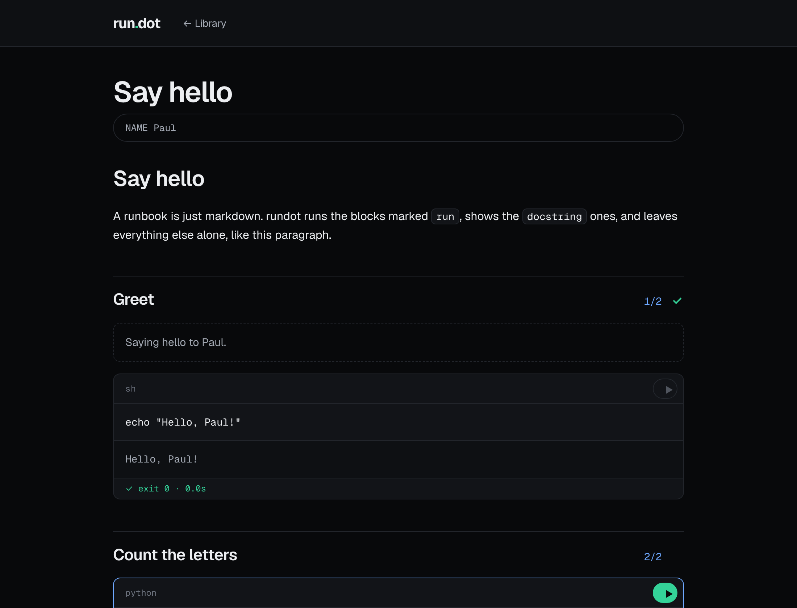

## Starting it

```sh
rundot web RELEASING.md        # a file
rundot web rebuild-frontend    # a book in your library
rundot RELEASING.md --web      # the same as rundot web RELEASING.md
rundot web                     # your library
```

`RUNBOOK` is found as for [`rundot run`](cli.md#naming-a-runbook). rundot checks it first, and a runbook with errors stops here, as it would under `rundot run`. Then rundot opens your browser and prints:

```
rundot web: http://127.0.0.1:51234/book/RELEASING?t=V8m0kq3s…
Ctrl-C to stop
```

The page stays up until you press Ctrl-C. Blocks run in the folder you started `rundot web` from. See [`rundot web`](cli.md#rundot-web) for `--port` and `--no-browser`.

## The page

The runbook's `title` is at the top, with its `description` under it, then a form for its [inputs](runbook-format.md#inputs). The rest of the runbook follows as it reads on GitHub.

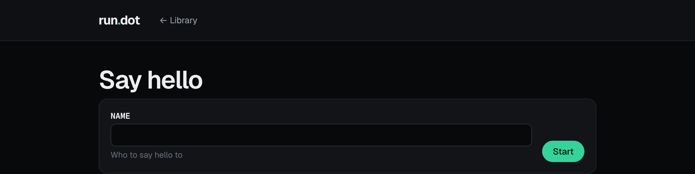

A secret is a password field:

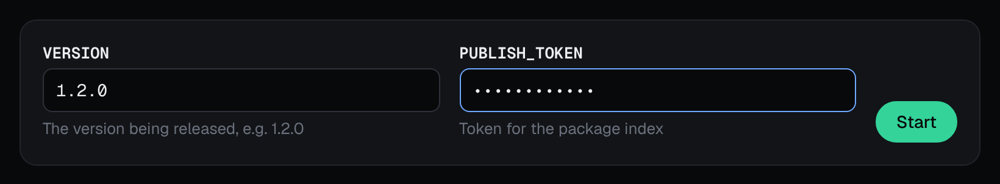

Fill in the form and press **Start**. A value that doesn't fit the input's `pattern` or `choices` shows why under its field. Once the run starts, the form folds into one line, with secrets as `****`:

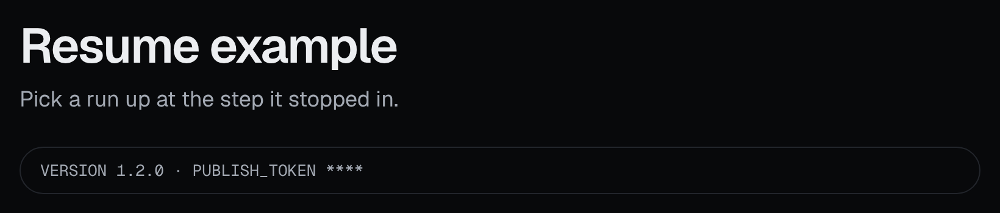

## Running each block

Only the next block's ▶ can be pressed. Blocks before it are done, and blocks after it wait their turn. Press ▶ to run it.

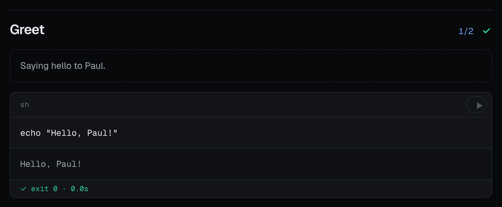

- What a block prints shows under it, as it's printed. Lines it writes to stderr are red.
- The block ends with `✓ exit 0` or `✗ exit 1` and how long it took.
- Each step heading shows `n/total`, then ✓ or ✗ once the step is done.
- Placeholders such as `<NAME>` are filled in once the run starts, in every block, including those the run hasn't reached yet. A value an `input` block asks for fills in the blocks after it once it's given. Secrets never are.

### Confirms

A [`confirm`](runbook-format.md#blocks) block waits for you to do something by hand. Press **Done** once you have, or **Stop** to end the run there.

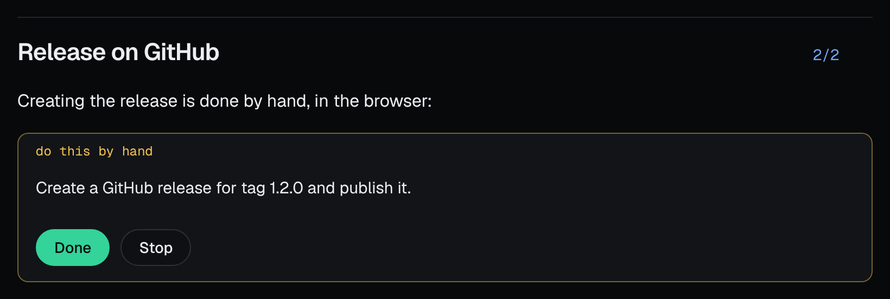

### Input blocks

An [`input` block](runbook-format.md#input-blocks) is a field where it sits in the runbook. It's checked against its `pattern` and `choices`, as in the terminal:

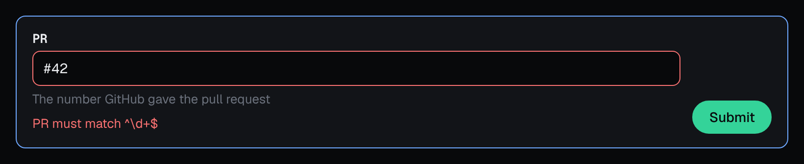

## When a block fails

The run stops at the block that failed, with its output and exit code:

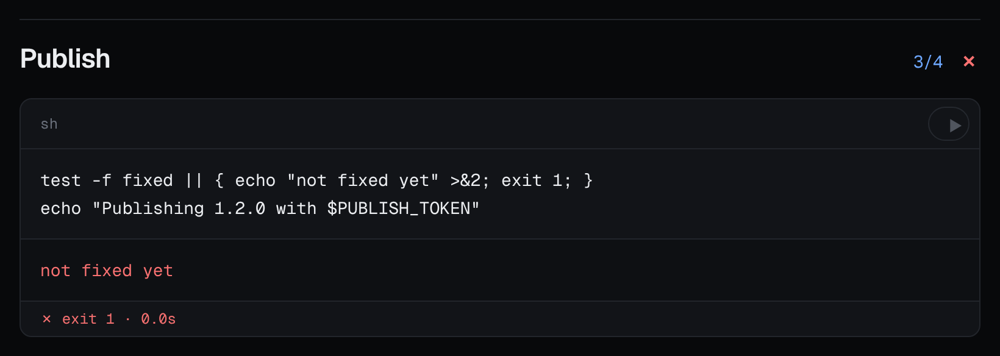

The top of the page says where it stopped:

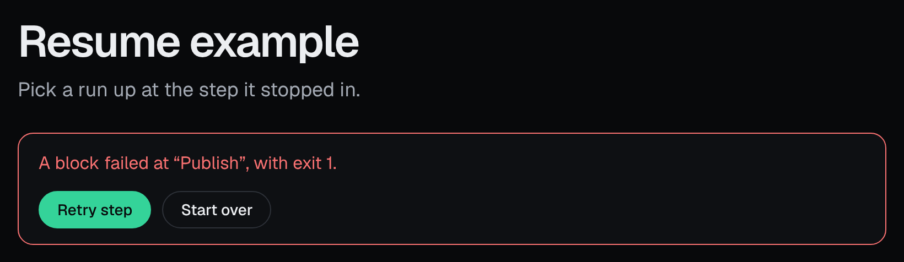

- **Retry step** runs the step again from its start, once you've fixed the problem.
- **Start over** forgets the stopped run and goes back to the form.

A run ended with **Stop** gets the same buttons. When a run finishes, **Run again** starts a new one.

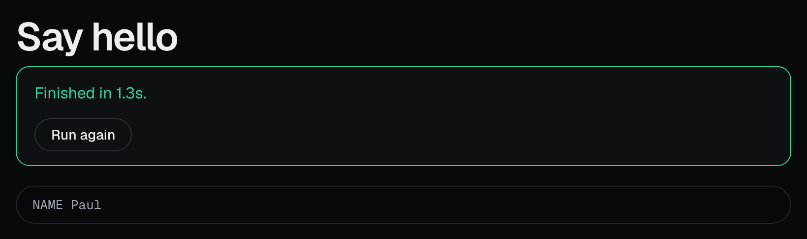

## Resuming

A run stopped in the browser can be resumed with `rundot run`, and a run stopped with `rundot run` can be resumed in the browser. Both use the same [saved state](runbook-format.md#resuming-a-run) and write the same transcript.

Opening a runbook whose last run stopped part way shows where it stopped:

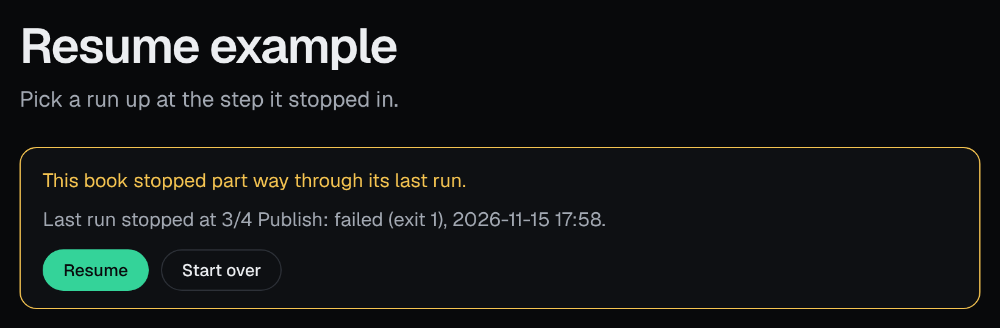

- **Resume** picks the run up at the start of the step it stopped in. Plain inputs come from the stopped run. Secrets are never saved, so the form asks for them again.
- **Start over** forgets the stopped run.

If the runbook has changed since that run, the banner says what changed, as `rundot run` does.

## The library

`rundot web` with no runbook opens on your [library](library.md). Every page has **← Library** at the top, which goes back to it. A runbook you opened by its path is listed first.

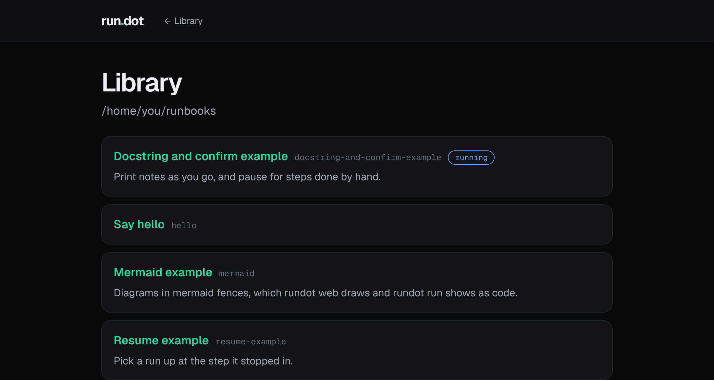

## One run at a time

Only one book runs at a time, and only the tab that started a run can answer it. Open another book while one is running, or the running book in a second tab, and the page says which one is running. A second tab of the running book replays the run so far and follows it live, but its buttons wait until that run is done, as another book's do.

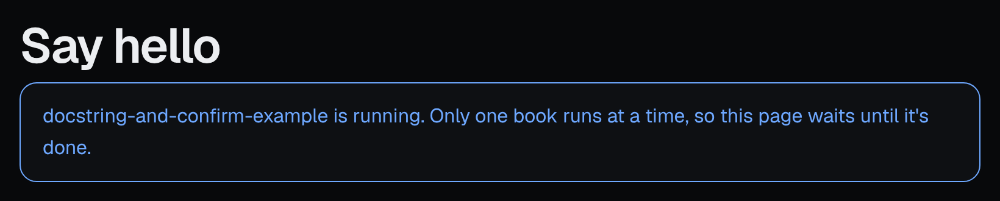

Reloading the tab that started the run replays the run so far, and it carries on from there. The tab keeps its place through a reload, but not once it's closed. Then Ctrl-C in the terminal stops `rundot web` and saves the run as interrupted, and the next `rundot web` can resume it. Duplicating that tab copies its place too, so the copy can answer the run as well.

## Diagrams and HTML

A ```` ```mermaid ```` block is drawn as a diagram, and raw HTML such as `<details>` renders as it does on GitHub. See [In the browser](runbook-format.md#in-the-browser).

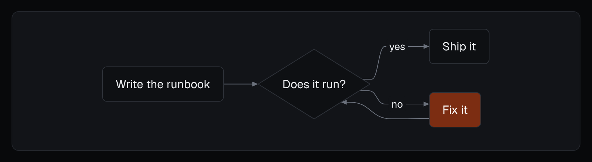

## In a narrow window

The page fits a window as narrow as a phone's:

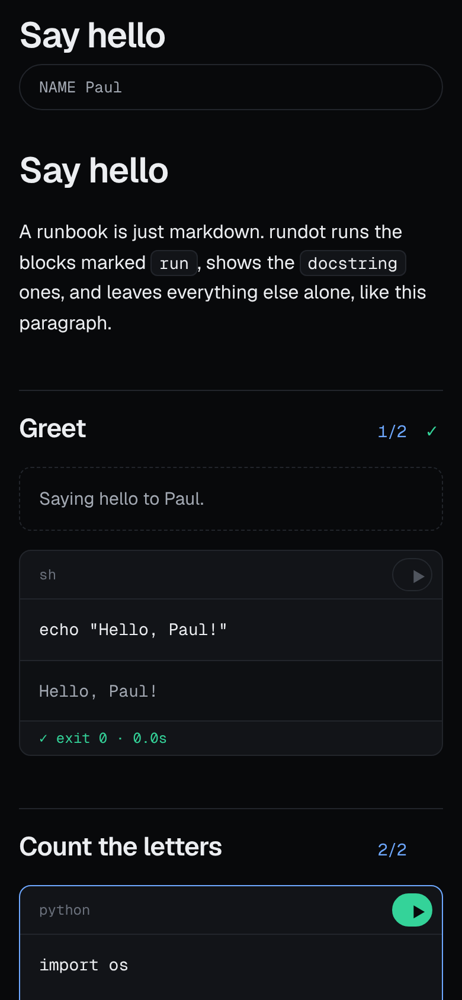

## Pressing Ctrl-C

Press Ctrl-C in the terminal to stop `rundot web`. A running block gets the Ctrl-C too, and rundot waits for it to stop. The run is saved as interrupted, so it can be resumed, and `rundot web` exits with code 130. If a block ignores it, press Ctrl-C again to stop waiting.

## Security

The page runs commands on your computer, so only you can reach it:

- It listens on `127.0.0.1` only. There's no option to listen anywhere else.
- It refuses any request whose `Host` isn't `127.0.0.1` or `localhost` on its port, so another website can't reach it through DNS.
- It refuses any button press that doesn't come from its own pages, by their `Origin`, so another website open in your browser can't press ▶.
- The URL rundot prints has a one-time token. The first visit swaps it for a cookie that only this server's pages get (`HttpOnly`, `SameSite=Strict`), and every request after that needs the cookie. Other programs and users on your computer don't have it.
- Every page is sent with `Content-Security-Policy: default-src 'self'`, so a script that gets into a runbook's HTML can't run.
- Secret values never reach the browser after you submit them. Output is masked before it's sent, as it is in the terminal and the transcript.

## Offline

The page's styles, fonts, script and diagram renderer are all inside rundot. Nothing is fetched from the internet, so it works with no network.
