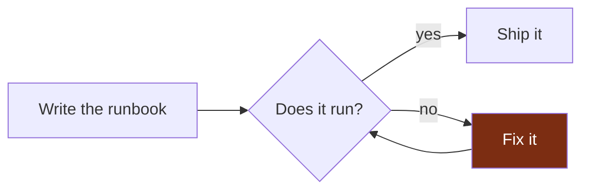
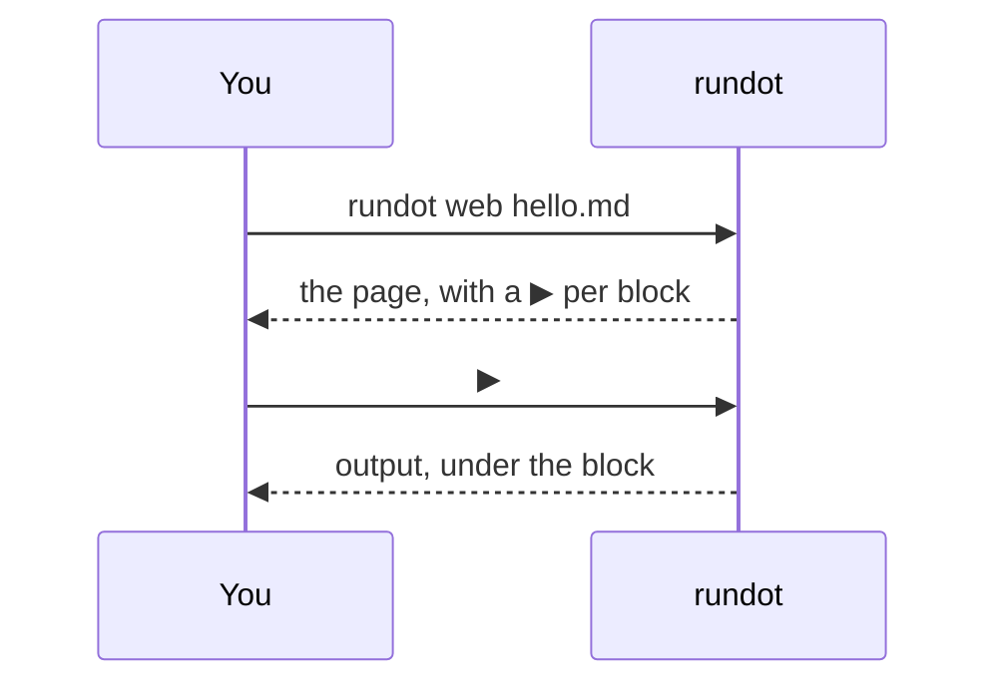
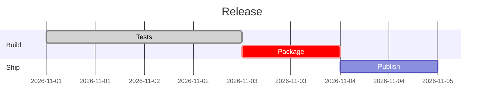

# Mermaid example

A flowchart:



A sequence diagram:



A Gantt chart:



This one is broken, so it stays as code with Pele's error under it:

```mermaid
flowchart LR
  A -->
```

## Say it

```sh run
echo "diagrams drawn"
```
